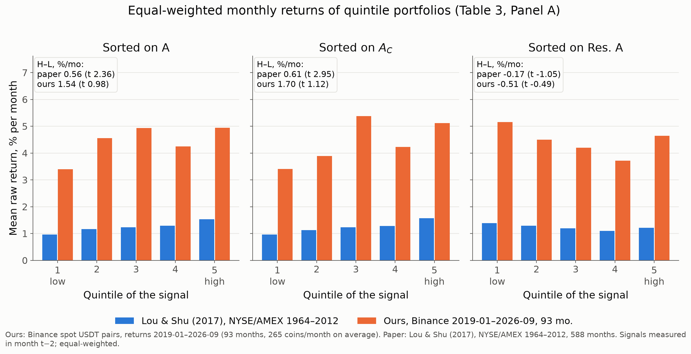

# Lou & Shu (2017) на Binance: премия Amihud — за объём торгов или за price impact?

**Team 12, Paper 15** · RS3 (DSBA-3, ВШЭ) · репликация и апгрейды статьи
X. Lou, T. Shu, *Price Impact or Trading Volume: Why Is the Amihud (2002) Measure Priced?*, RFS 30(12), 2017.
Парная статья для критики: Y. Amihud, J. Noh, *Illiquidity and Stock Returns II*, RFS, 2021.

<!-- BEGIN:team -->
**Состав команды:** _не заполнено: `slides/meta.yaml` → team_  
**Репозиторий:** https://github.com/bigpurota/paper15-lou-shu
<!-- END:team -->

<!-- BEGIN:provenance -->
_Числа в этом файле сгенерированы `src/build_docs.py` из CSV: базовый прогон `20261016T135240Z_3e8eb87e` (git `9ddffbb (dirty)`, config sha256 `3e8eb87e…`), симуляции `results/simulations/` (`sim_20261016_191215`, config `3e8eb87e…`, git `aa8f4aa (dirty)`), апгрейды `amihud_noh` → `20261016T141015Z_amihud_noh`, `edge_spread` → `20261016T141008Z_3e8eb87e_edge_spread`, `hf_lambda` → `hf_lambda_20261016T154107Z_3e8eb87e`, `moex` → `moex_20261016T144811Z_b4264d55`, `openap_us` → `20261016T140227Z_openap_us`, `robustness` → `robustness_20261016T162250Z`, `sentiment` → `sentiment_20261016T140147Z`. Обновление: `make docs`. Числа между маркерами `<!--v:...-->` руками не правятся. Пока в манифестах стоит `(dirty)`, код, давший результаты, однозначно задают поля `code_sha256` манифестов (sha256 файлов), а не git SHA._
<!-- END:provenance -->

Весь код написан нами с нуля (кода авторов нет); эталонные пакеты (`bidask`, `statsmodels`) используются только как тесты. Каждое число в этом README и в `slides/PLAN.md` подставлено скриптом `src/build_docs.py` из CSV в `results/`; руками не вписано ничего.

## Тезис (шаблон лекции)

> **Авторы утверждают**, что мера Amihud прайсится не потому, что измеряет price impact, а потому, что почти целиком состоит из обратного долларового объёма, **потому что** «константная» мера `A_C = mean_d(1/DVol_d)` даёт ту же премию, что и `A`, а часть `A`, ортогональная `A_C` (`Res.A`), не прайсится или прайсится со знаком минус, **используя** квинтильные сортировки, регрессии Fama–MacBeth с сигналом из месяца t−2 и t-статистиками Newey–West на акциях NYSE/AMEX 1964–2012. **Самый слабый шаг** — переход от «остаток не прайсится» к «price impact не прайсится»: в разложении `ln A = ln|Ret| + ln A_C` потерян ковариационный член `cov(|r|, 1/DVol)` (Amihud & Noh 2021), а сам остаток в основном состоит из волатильности. **Я бы проверил его так:** посчитать пропущенный член `DIF` и проверить, прайсится ли он сверх `A_C`; проверить, переживает ли `Res.lnA` контроль `ln|Ret|` и IVOL; и сравнить `A` с прямым price impact λ по 5-минутным барам, где знак торговли точный (taker-buy объём Binance, без Lee–Ready), а сам бар-λ сверен с потрейдовым λ по `aggTrades`.

### Наш ответ в одном абзаце

На Binance (<!--v:n.months-->93<!--/v--> месяцев, в среднем <!--v:n.avgcoins-->265<!--/v--> монет в месяц) **знаки статьи воспроизводятся, значимость — нет**: квинтильный спред по `A_C` <!--v:pvu.HLACrawCoef-->1.70 (t 1.12)<!--/v--> %/мес против <!--v:pvu.HLACrawCoef.paper-->0.61 (t 2.95)<!--/v--> у статьи, FM `ln A_C` <!--v:pvu.FMlnAC-->0.760 (t 1.53)<!--/v--> против <!--v:pvu.FMlnAC.paper-->0.183 (t 4.79)<!--/v-->. Порог Harvey–Liu–Zhu (|t| > 3) проходят <!--v:sc.hlz-->0<!--/v--> из <!--v:sc.ls_n-->28<!--/v--> коэффициентов базовой таблицы. Это **не опровержение**: минимальный обнаружимый эффект (80% мощности) для спреда `A_C` равен <!--v:mde.hlAC-->4.27<!--/v--> %/мес, в <!--v:mde.hlAC.ratio-->7.0<!--/v--> раза больше премии статьи. Остаток `Res.lnA` отрицателен (<!--v:pvu.FMResLnA-->-5.09 (t -2.46)<!--/v-->), как в статье, и исчезает при контроле `ln|Ret|` и IVOL (<!--v:an.V5m-->-0.143 (t -0.05)<!--/v-->). Это почти механично: `ln A = ln|Ret| + ln A_C + DIF`, поэтому после вычитания `ln A_C` остаток — это в основном `ln|Ret|` (R² <!--v:an.r2_res_abs-->0.61<!--/v-->) и почти целиком `ln|Ret| + DIF` (R² <!--v:an.r2_res_dif-->0.87<!--/v-->). Такой тест не отделяет волатильность от price impact: после `|Ret|` от остатка остаётся член Amihud & Noh `DIF`, а он не прайсится (<!--v:an.V1m-->-1.64 (t -0.44)<!--/v-->). «Остаток — это волатильность» для нас гипотеза, а не доказательство против price impact. Спор Lou & Shu против Amihud & Noh наши данные **не разрешают**: предпосылка A&N выполняется (`COV < 0` в <!--v:an.covneg-->98.8%<!--/v--> монето-месяцев), но `DIF` не прайсится; единственный результат в сторону A&N — `fDIF` на 12-месячных мерах (<!--v:an.V4y-->45.12 (t 2.14)<!--/v--> против <!--v:an.p.fdif-->1.261 (t 3.29)<!--/v--> у A&N, ниже HLZ), а вердикт заранее заданного правила меняется с минимальным числом монет в месяце. Прямой price impact λ (5-минутные бары, знак из taker-объёма, <!--v:hf.months-->36<!--/v--> месяцев) хорошо коррелирует с `A` (<!--v:hf.corr.A-->0.615<!--/v--> против <!--v:hf.corr.A.paper-->0.737<!--/v--> у статьи) и прайсится **со знаком минус** (<!--v:hf.b1-->-2.59 (t -4.03)<!--/v-->). Это расходится с моделью (1) Table 9 статьи (<!--v:hf.b1.paper-->-0.034 (t -0.67)<!--/v-->), но в её модели (2) ln λ тоже отрицателен и значим (<!--v:hf.b2lam.paper-->-0.155 (t -2.51)<!--/v-->); при этом в нашем окне λ нет и самой премии `A_C` (<!--v:hf.b0-->-0.435 (t -1.56)<!--/v-->), так что Table 9 мы не воспроизводим. На MOEX FM-результат статьи повторяется (`ln A_C` <!--v:mx.fm2-->0.308 (t 2.87)<!--/v-->), на США после 2012 года премии `Illiquidity` и `DolVol` исчезли.

## Что внутри (P0 и апгрейды)

| Ступень шкалы курса | Где |
|---|---|
| Свой код: меры, сортировки, FM + Newey–West, факторы | `src/measures.py`, `src/sorts.py`, `src/fama_macbeth.py`, `src/factors.py`, `src/analysis.py` |
| Проверка на симуляции с известным ответом (миры V / P / 0) | `src/simulate.py`, `results/simulations/`, раздел «Симуляции» ниже |
| Похожие результаты + объяснение расхождений | `results/<run>/paper_vs_us.md`, раздел «Статья против нас» |
| Наш график рядом с графиком статьи на одних осях | `results/<run>/fig_quintiles.png` |
| Апгрейды (8 штук) | `results/upgrades/*/SUMMARY.md`, раздел «Апгрейды» |
| Слайд про переобучение | раздел «Переобучение», `results/upgrades/robustness/` |

## Данные

- **Рынок:** Binance spot, все пары к USDT из листинга `data.binance.vision`, **включая делистинг** (вселенная без survivorship bias), дневные klines. Исключены стейблкоины, фиат, золото, обёрнутые и стейкинговые токены, плечевые токены (`config.yaml → universe`).
- **Выборка:** доходности <!--v:n.first-->2019-01<!--/v-->…<!--v:n.last-->2026-09<!--/v-->, <!--v:n.months-->93<!--/v--> месяцев, <!--v:n.coinmonths-->24 628<!--/v--> монето-месяцев, <!--v:n.coins-->626<!--/v--> монет, в среднем <!--v:n.avgcoins-->265<!--/v--> монет в месяц; в Fama–MacBeth <!--v:n.fmmonths-->87<!--/v--> месяцев и в среднем <!--v:n.fmobs-->214<!--/v--> монет на месяц оценки (`T4_fm.csv`, `avg_obs` модели (1)). Столбец `sample.csv → avg_coins_fm` (<!--v:n.avgcoins_fm_all-->201<!--/v-->) усредняет по всем <!--v:n.months-->93<!--/v--> месяцам, включая <!--v:n.fm_dropped-->6<!--/v--> ранних месяцев, где монет меньше минимума FM (k+10, D16) и поперечная регрессия не строится. Фильтры как в статье: не меньше 10 валидных дней в месяце, плюс минимальный средний долларовый объём.
- **Аудит данных** (`src/data_audit.py`, журнал J1 в `DEVIATIONS.md`). Klines Binance не скорректированы на редоминации. Поскольку Binance торгует 24/7, любое настоящее движение открывается по прошлому закрытию, а редоминация — после остановки торгов по закрытию, делённому на 10^k, при скачке объёма в базовой валюте и непрерывном долларовом объёме. Аудит нашёл <!--v:audit.TOTAL-->17<!--/v--> событий: <!--v:audit.redenomination-->8<!--/v--> редоминаций (скорректированы как сплиты CRSP), <!--v:audit.ticker_reuse-->2<!--/v--> повторных использования тикера и <!--v:audit.long_gap-->4<!--/v--> долгих пауз (новый актив `<SYM>#2`), <!--v:audit.zero_volume-->2<!--/v--> серии без объёма (строки удалены), <!--v:audit.open_mismatch-->1<!--/v--> случай только для отчёта. Дневных строк: <!--v:audit.rows_in-->788 692<!--/v--> → <!--v:audit.rows_out-->788 689<!--/v-->; идентификаторов активов: <!--v:audit.ids_in-->678<!--/v--> → <!--v:audit.ids_out-->684<!--/v-->. Даты всех редоминаций совпадают с остановками торгов в klines, а коэффициенты — с формой скачка цены и объёма в базовой валюте (`audit_events.csv`); сверка с объявлениями проектов и бирж делалась вручную, источники в репозитории не хранятся (`DEVIATIONS.md`, J1). Крах LUNA в мае 2022 остаётся в данных как реальное падение.

<details><summary>Все события аудита (<code>audit_events.csv</code>)</summary>

<!-- BEGIN:audit -->
| монета | дата | тип | фактор (редоминация) / reopen÷prev close | обработка |
|---|---|---|---|---|
| BCC | 2018-11-20 | zero_volume |  | drop_row |
| BNX | 2023-02-22 | redenomination | 100 | split_adjust |
| BTCST | 2021-03-19 | redenomination | 10 | split_adjust |
| COCOS | 2021-01-23 | redenomination | 0.001 | split_adjust |
| CVC | 2023-05-12 | long_gap | 0.91 | new_asset |
| DREP | 2021-04-02 | redenomination | 0.01 | split_adjust |
| FTT | 2023-09-22 | long_gap | 0.6809 | new_asset |
| KEY | 2023-03-10 | long_gap | 1.841 | new_asset |
| KLAY | 2024-10-29 | zero_volume |  | drop_row |
| LUNA | 2022-05-31 | ticker_reuse | 2e+04 | new_asset |
| NBT | 2022-10-01 | long_gap | 0.8649 | new_asset |
| QUICK | 2023-07-21 | redenomination | 1000 | split_adjust |
| SCR | 2024-10-22 | open_mismatch | 0.5727 | none |
| STRAX | 2024-03-28 | redenomination | 10 | split_adjust |
| SUN | 2021-06-18 | redenomination | 1000 | split_adjust |
| VEN | 2018-10-19 | ticker_reuse | 5.459e-05 | new_asset |
| VIDT | 2022-11-09 | redenomination | 10 | split_adjust |
<!-- END:audit -->

</details>

- **Апгрейды** берут дополнительно: 5-минутные klines Binance (λ, <!--v:hf.months-->36<!--/v--> месяцев) и `aggTrades` (сверка λ на подвыборке), MOEX ISS (режим TQBR, дивиденды), портфели Open Source Asset Pricing (`Illiquidity`, `DolVol`) и факторы Kenneth French, Crypto Fear & Greed (alternative.me).
- Скачанное — недоверенный ввод: хранится в `data/raw/<источник>/` (в `.gitignore`), Python запускается с `-I`.

## Как запустить

Нужен `Python 3.12` (`make venv` берёт `uv`, если он установлен, иначе `python3.12 -m venv` и `pip`), macOS или Linux, сеть при первом запуске. Для `make slides` — TeX Live (`xelatex`, `latexmk`) и шрифт Arial.

```bash
make venv       # .venv + закреплённые версии из requirements.txt (uv или venv + pip)
make p0         # data → tests → sims → run → report → figures   (ступени 6–8 шкалы)
make upgrades   # 7 модулей апгрейдов (каждый пишет results/upgrades/<имя>/)
make ledger     # реестр всех t-статистик (после апгрейдов) + SUMMARY робастности
make docs       # пересобрать числа в README.md и slides/PLAN.md из CSV
make all        # всё по порядку: p0 → upgrades → ledger → docs
make all-light  # то же без upgrade-hf_lambda (он скачивает ~5 ГБ); его результаты остаются из git
make slides     # docs + колода slides/paper15_team12_LouShu2017.pdf (числа — макросы из results/)
make zip        # ../paper15-lou-shu-team12.zip: код + results/, без data/ и .venv
make -n all     # показать всю цепочку без запуска
```

- `make data` скачивает klines один раз и пропускает загрузку, если `data/cache/daily.parquet` уже есть. Пересобрать кэш из локальных zip без сети: `.venv/bin/python -I src/data_binance.py config.yaml --rebuild`.
- Каждый `make run` создаёт новую папку `results/<run_id>/` и переставляет `results/LATEST`; апгрейды и отчёты читают базовый прогон из `LATEST`.
- `make upgrade-<имя>` запускает один апгрейд: `amihud_noh`, `hf_lambda`, `edge_spread`, `sentiment`, `openap_us`, `moex`, `robustness`.
- Самый тяжёлый шаг — `upgrade-hf_lambda`: при первом запуске скачивает <!--v:hf.gb5m-->4.3<!--/v--> ГБ 5-минутных klines и <!--v:hf.gbagg-->1.0<!--/v--> ГБ `aggTrades` (ГБ = 10^9 байт, суммы zip из `results/upgrades/hf_lambda/downloads.csv`; таблица ниже считает все файлы папок, поэтому чуть больше). Флаг `--no-download` считает только по уже скачанным файлам и помечает прогон как офлайн.

<!-- BEGIN:runtime -->
| этап | секунд (последний прогон, кэш данных есть) | источник |
|---|---|---|
| `make run` (базовый прогон) | 25 | `results/20261016T135240Z_3e8eb87e/run_manifest.json` |
| `make sims` (симуляции, параллельно) | 143 | `results/simulations/sim_manifest.json` |
| `make report` | 1.6 | `results/20261016T135240Z_3e8eb87e/report_manifest.json` |
| `make upgrade-amihud_noh` | 15 | `results/upgrades/amihud_noh/run_manifest.json` |
| `make upgrade-edge_spread` | 39 | `results/upgrades/edge_spread/run_manifest.json` |
| `make upgrade-hf_lambda` | 118 | `results/upgrades/hf_lambda/run_manifest.json` |
| `make upgrade-moex` | 32 | `results/upgrades/moex/run_manifest.json` |
| `make upgrade-openap_us` | 0.2 | `results/upgrades/openap_us/run_manifest.json` |
| `make upgrade-robustness` | 6.0 | `results/upgrades/robustness/run_manifest.json` |
| `make upgrade-sentiment` | 6.1 | `results/upgrades/sentiment/run_manifest.json` |

Время загрузки данных в манифесты не пишется: оно зависит от сети. Объём сырых данных (считается при сборке документации):

| папка | МБ (10^6 байт) на машине автора |
|---|---|
| `data/raw/aggtrades/` | 1025.5 |
| `data/raw/fng/` | 0.3 |
| `data/raw/french/` | 0.0 |
| `data/raw/klines/` | 45.5 |
| `data/raw/klines5m/` | 4314.6 |
| `data/raw/moex/` | 56.7 |
| `data/raw/openap/` | 3.5 |
<!-- END:runtime -->

## Статья против нас

Ключевой рисунок: средние доходности квинтилей `A`, `A_C`, `Res.A`, статья (Table 3, Panel A) и мы на одних осях.

<!-- BEGIN:figure_main -->


_Файл: `results/20261016T135240Z_3e8eb87e/fig_quintiles.png` (генерирует `src/figures.py`)._
<!-- END:figure_main -->

Остальные рисунки той же папки: `fig_tstats.png` (t-статистики статьи и наши рядом, с линиями 1.96 и HLZ), `fig_hl_ci.png` (спреды H-L с 95% ДИ), `fig_hl_cumulative.png` (накопленный H-L по месяцам), `fig_an_dif.png` (член Amihud & Noh), `fig_quintiles_demeaned.png`. Макросы LaTeX со всеми числами для слайдов: `results/<run>/tex/numbers.tex`.

<!-- BEGIN:paper_vs_us -->
_Ниже — дословно `results/20261016T135240Z_3e8eb87e/paper_vs_us.md` (генерирует `src/report.py`), разделы «Key findings» и «Paper vs us»._

#### Key findings
- **Scorecard.** Of 28 Lou & Shu coefficient rows, 13 match, 14 match in sign only and 1 is 'no' (opposite sign); 10 of these t-statistics have |t| ≥ 1.96 and 0 have |t| > 3 (HLZ bar). Several rows are overlapping specifications of the same few signals, so they are not independent tests. Against Amihud & Noh (2021), 2 of 2 rows have the opposite sign (A&N col. 4 is the same regression as our model (5)). 31 of 45 robustness variants keep the base conclusion (`robustness_vs_base.csv`).
- **Volume component (A_C).** Sorts give 1.701 (t 1.12) and FM gives 0.760 (t 1.53); both have the paper's sign, and they are not significant. The most influential month for the sort is 2021-03 (H-L 150.3%, CMKT 139.4%); without it the spread is 0.09 (t 0.08). The FM slope is 1.98 (t 2.59) in 2019-01..2022-10 and -0.28 (t -1.09) in 2022-11..2026-09.
- **Price-impact residual (Res. ln A).** FM model (3) gives -5.092 (t -2.46), the paper's sign. |t| is above the world-0 5% critical value (2.15) and below the HLZ bar of 3. Across the robustness variants of models (3) and (4), 7 of 8 keep the conclusion; it changes in: FM Res.lnA (4): second half. Hypothesis: this is a volatility effect, since corr(Res. A, |Ret|) = 0.37 and ln|Ret| is -9.051 (t -2.50) in the T2 decomposition.
- **Power.** Monthly coin returns have s.d. 43.9%, and the standard error of the A_C spread is 3.4 times its value in the world-0 simulation of similar size (90 months, 298 coins). The 80%-power MDE for the A_C spread is 4.27%/mo against the paper's 0.61, so our insignificant spreads cannot reject a stock-sized premium.
- **Different market.** Across coins volatility and dollar volume move together (corr(ln DVol, ln|Ret|) = 0.26, slope 1.12), and corr(A, |Ret|) is -0.133, against 0.489 for stocks.

#### Paper vs us

t-statistics: Newey–West, 6 lags. Columns: *Match?* follows the rule below; *|t|>3* is our statistic against the Harvey–Liu–Zhu bar; *MDE80* is the effect we could detect with 80% power (two-sided 5%), (1.96+0.84)·SE, in the row's units.

| Metric | Paper | Us (Binance 2019-01–2026-09, 93 mo.) | Match? | \|t\|>3 | MDE80 | Why it differs / matches |
|---|---|---|---|---|---|---|
| **Table 1: descriptive statistics** | | | | | | |
| corr(A, A_C) | 0.899 | 0.956 | yes |  |  | Matches. A and A_C share the 1/DVol term, and across coins ln DVol varies much more than ln\|Ret\| (Q75/Q25 9.4 for A_C vs 1.75 for \|Ret\|), so A is mostly A_C, as in the paper. |
| corr(A, \|Ret\|) | 0.489 | -0.133 | no |  |  | Opposite sign. Across coins dollar volume rises with volatility: the average monthly cross-sectional corr(ln DVol, ln\|Ret\|) is 0.26, and the slope of ln DVol on ln\|Ret\| averages 1.12 (median 1.51). Dividing \|Ret\| by DVol therefore cancels the \|Ret\| variation: corr(ln A, ln\|Ret\|) = 0.00. Hypothesis: in stocks, size drives both low volume and high volatility, so they move together; in crypto, volatility attracts trading (retail attention, pumps, possibly wash trading). |
| corr(A_C, \|Ret\|) | 0.394 | -0.247 | no |  |  | Opposite sign, same mechanism: volatile coins have higher DVol and so lower A_C (corr(ln A_C, ln\|Ret\|) = -0.15). In crypto a 'liquid' (low A_C) coin tends to be a volatile one, while the \|Ret\| part of A sits in Res. A (corr(Res.A, \|Ret\|) = 0.37). |
| Q75/Q25 of A_C | 116.60 | 9.396 | no |  |  | Liquidity is much less dispersed than among NYSE/AMEX stocks. The universe is Binance USDT pairs and the $10k/day filter removes the illiquid tail (D8); median DVol is 3.4 $M/day. Hypothesis: listing on Binance itself acts as a liquidity screen. |
| Q75/Q25 of \|Ret\| | 2.182 | 1.746 | yes |  |  | Relative dispersion is similar, but the level is much higher: median daily \|Ret\| is 3.76% here vs 1.6% in the paper. |
| **Table 2: decomposition of ln A** | | | | | | |
| FM ln A_C, with ln\|Ret\| (Table 2 model 3) | 0.165 (t 3.92) | 0.814 (t 1.46) | sign only | no | 1.57 | Same sign, not significant (t 1.46). The positive A_C part and negative \|Ret\| part of the paper's decomposition both appear, but only the \|Ret\| part is significant. There is no ln ME or B/M control (D2, D3). MDE80 = 1.57. |
| FM ln\|Ret\|, with ln A_C (Table 2 model 3) | -0.319 (t -2.13) | -9.051 (t -2.50) | yes | no | 10.14 | Matches: ln\|Ret\| is negative and significant at 1.96 (t -2.50) but below the HLZ bar of 3.0. Slopes are in %/mo per log unit, and coin returns are far more dispersed (s.d. 43.9%/mo), so all our slopes are larger in absolute terms. Hypothesis: this is the same volatility effect that Res. ln A picks up in Table 4 (corr(Res.A, \|Ret\|) = 0.37). |
| **Table 3: quintile sorts (EW, signal in t-2)** | | | | | | |
| H-L on A, raw (%/mo) | 0.560 (t 2.36) | 1.543 (t 0.98) | sign only | no | 4.42 | Same sign with a larger point estimate, but not significant. Coin-month returns are very noisy (s.d. 43.9%/mo, p99 158.4%), and we have 93 months (paper 588) with 265 coins per month, so MDE80 = 4.42%/mo against the paper's 0.560. Most influential month: 2021-03 (H-L 145.0%, CMKT 139.4%); without it the mean is -0.02 (t -0.01). |
| H-L on A, alpha (%/mo) | 0.350 (t 2.31) | 0.556 (t 0.48) | sign only | no | 3.28 | Same sign, not significant. Alpha is on CMKT+CMOM, not FF3+UMD (D6). It is smaller than the raw spread (1.54), so part of the raw spread is CMKT/CMOM exposure. MDE80 = 3.28. |
| H-L on A_C, raw (%/mo) | 0.610 (t 2.95) | 1.701 (t 1.12) | sign only | no | 4.27 | Same sign, not significant (MDE80 = 4.27%/mo; at this point estimate t would reach 1.96 after about 287 months, an estimate assuming SE falls as 1/sqrt(T)). Most influential month: 2021-03 (H-L 150.3%, CMKT 139.4%, cross-sectional mean coin return 140.1%); without it the spread is 0.09 (t 0.08). Median monthly H-L -0.26; positive in 49% of months. By half: 3.39 (t 1.21) in 2019-01..2022-10 vs 0.05 (t 0.05) in 2022-11..2026-09. |
| H-L on A_C, alpha (%/mo) | 0.440 (t 3.20) | 0.781 (t 0.62) | sign only | no | 3.55 | Same sign, not significant. Alpha is on CMKT+CMOM (D6) and is smaller than the raw spread (1.70). MDE80 = 3.55. |
| H-L on Res.A, raw (%/mo) | -0.170 (t -1.05) | -0.510 (t -0.49) | yes | no | 2.92 | Matches the paper: no significant spread on the price-impact residual (quintiles Q1..Q5: 5.15 / 4.49 / 4.19 / 3.72 / 4.64). With MDE80 = 2.92, a null here is weak evidence on its own. |
| H-L on Res.A, alpha (%/mo) | -0.160 (t -0.96) | -1.000 (t -1.01) | yes | no | 2.76 | Matches (not significant). Alpha is on CMKT+CMOM (D6). Two of the weighting variants are significant: liquid half -3.47 (t -2.82) and DVol weights -3.29 (t -2.38), with the sign of the negative Res. ln A slope in FM; their raw-return spreads are not (-2.82, t -1.71; -2.80, t -1.82). See the robustness table for all variants. |
| **Table 4: Fama-MacBeth, risk-adjusted returns** | | | | | | |
| FM ln A, model (1) | 0.119 (t 3.01) | 0.580 (t 1.24) | sign only | no | 1.31 | Same sign, not significant. Returns are CMKT-adjusted with 36-month betas (D4), with no ln ME or B/M controls (D2, D3). FM uses 87 months and 214 coins per month (paper 588 and 1775). MDE80 = 1.31. |
| FM ln A_C, model (2) | 0.183 (t 4.79) | 0.760 (t 1.53) | sign only | no | 1.39 | Same sign, not significant. Per log unit of ln A_C, MDE80 = 1.39 against the paper's slope 0.183. Per 1 s.d. of ln A_C, each in its own s.d., our slope is 1.17%/mo and MDE80 = 2.15 (our cross-sectional s.d. 1.54), against the paper's 0.46 (its s.d. 2.53, p. 13); the paper's slope times our s.d. is 0.28. Without the most influential month (2021-03) the slope is 0.33 (t 0.97). First half 1.98 (t 2.59), second half -0.28 (t -1.09). |
| FM Res.lnA, model (3) | -0.383 (t -5.07) | -5.092 (t -2.46) | yes | no | 5.79 | Matches: negative and significant at 1.96 (t -2.46), but below the HLZ bar of 3.0. In world-0 simulations, NW(6) gives \|t\|>1.96 in 9.5% of runs (95% CI 5.8-14.4), and the empirical 5% critical \|t\| is 2.15; our \|t\| is above it. Without the most influential month (2021-04) the slope is -4.55 (t -2.35). Hypothesis: a volatility effect rather than a price-impact premium. Res. A is positively correlated with \|Ret\| (0.37), and ln\|Ret\| has the same negative sign in T2. |
| FM ln A_C, model (4) with Res.lnA | 0.130 (t 3.31) | 1.022 (t 1.67) | sign only | no | 1.72 | Same sign, not significant (t 1.67). Without 2021-03 the slope is 0.53 (t 1.37). |
| FM Res.lnA, model (4) with ln A_C | -0.248 (t -3.14) | -8.103 (t -2.37) | yes | no | 9.57 | Matches at 1.96 (t -2.37), below HLZ 3.0. Without 2021-03 the slope is -6.65 (t -2.54). |
| FM ln A_C, model (5) with Res.lnA + IVOL | 0.120 (t 3.11) | 1.194 (t 1.70) | sign only | no | 1.97 | Same sign, not significant (t 1.70). MDE80 = 1.97. |
| FM Res.lnA, model (5) with ln A_C + IVOL | -0.303 (t -4.65) | -6.330 (t -1.98) | yes | no | 8.95 | Matches at 1.96 (t -1.98); adding IVOL moves the Res. ln A slope from -8.10 to -6.330. Our IVOL is a residual from a one-factor daily CMKT model (D7), and both IVOL and Res. ln A load on volatility. |
| FM IVOL, model (5) | -2.903 (t -0.57) | -101.34 (t -2.64) | sign only | no | 107.41 | Different: IVOL is significantly negative here (t -2.64) but not in the paper. The levels are not comparable (ours is a daily-residual s.d. from a one-factor CMKT model, D7); only sign and t are compared. Winsorized returns give t -3.15. |
| **Table 6: dollar volume directly** | | | | | | |
| FM ln DVol, with Res.lnA (Table 6 col. 1) | -0.158 (t -3.65) | -1.308 (t -1.81) | sign only | no | 2.03 | Same sign, not significant (t -1.81). Our Res. ln A is the residual on ln A_C, whereas the paper's Table 6 uses the residual on ln VOLUME; ln A_C is close to -ln DVol (mean cs corr -0.97). |
| FM Res.lnA, with ln DVol (Table 6 col. 1) | -0.167 (t -2.74) | -8.762 (t -2.29) | yes | no | 10.74 | Matches at 1.96 (t -2.29): the residual stays negative with ln DVol in the regression. The residual is still taken on ln A_C, not on ln VOLUME as in the paper (see the row above). |
| **Internet Appendix A.1: IMLA_C factor** | | | | | | |
| alpha of H-L(A) on IMLA_C (%/mo) | -0.040 (t -0.77) | 0.234 (t 0.50) | yes | no | 1.31 | Matches: controlling for IMLA_C (A_C tercile H-L) removes the A spread (raw 1.54 to 0.234), as in the paper. Weak evidence, since the raw spread was already insignificant. |
| alpha of H-L(A) on IMLA_C + factors (%/mo) | -0.080 (t -1.66) | 0.155 (t 0.35) | yes | no | 1.23 | Matches (not significant). Our factors are IMLA_C + CMKT + CMOM, the paper's are IMLA_C + FF3 + UMD (D6). |
| **Internet Appendix A.3: raw returns and sub-periods** | | | | | | |
| FM ln A, raw returns, model (1) | 0.081 (t 2.08) | 0.688 (t 1.39) | sign only | no | 1.39 | Same sign, not significant (t 1.39). On raw returns the paper's own slope is also weaker than on FF3-adjusted returns. |
| FM ln A_C, raw returns, model (2) | 0.095 (t 1.93) | 0.860 (t 1.70) | yes | no | 1.42 | Same sign, not significant (t 1.70); the paper's t 1.93 is also below 1.96. |
| FM Res.lnA, raw returns, model (3) | -0.143 (t -1.13) | -3.705 (t -2.11) | sign only | no | 4.92 | Our raw-return residual slope is significant (t -2.11), while the paper's is not. On raw returns the Res. ln A effect is stronger here than in the paper. |
| FM Res.lnA, raw returns, model (5) | -0.185 (t -2.23) | -6.037 (t -2.62) | yes | no | 6.47 | Matches: negative and significant at 1.96 (t -2.62). |
| FM ln A_C (2), first half vs 1964-1988 | 0.272 (t 4.71) | 1.982 (t 2.59) | yes | no | 2.15 | Same sign; significant at 1.96 (t 2.59), but below the HLZ bar, in our first half (2019-01..2022-10, 102 coins per FM month on average vs 309 in the second half). |
| FM Res.lnA (4), first half vs 1964-1988 | -0.222 (t -2.24) | -13.90 (t -2.29) | yes | no | 17.02 | Matches at 1.96 (t -2.29) in the first half. |
| FM ln A_C (2), second half vs 1989-2012 | 0.902 (t 1.98) | -0.280 (t -1.09) | no | no | 0.72 | Opposite sign: in the second half (2022-11..2026-09, 309 coins per FM month) the ln A_C slope is -0.280 (t -1.09). The paper's 1989-2012 model (2) value is printed as 0.902, ten times its other ln A_C slopes, probably a typo; its model (4) slope after 1989 is only 0.040 (t 0.90). Both samples show a weaker A_C effect later on. |
| FM Res.lnA (4), second half vs 1989-2012 | -0.275 (t -2.21) | -3.166 (t -1.40) | sign only | no | 6.35 | Same sign, not significant in the second half (t -1.40). |
| **Amihud & Noh (2021) critique (upgrade 1, base run)** | | | | | | |
| A&N (2021) col. 4: RlnILLIQ with ln A_C + IVOL | 0.736 (t 4.63) | -6.330 (t -1.98) | no | no | 8.95 | This is the same regression as model (5), set against A&N col. 4. 'no' means the sign is opposite to A&N's (+), not that a regression is missing; our sign agrees with Lou & Shu. A&N use 12-month measures on CRSP 1955-2016 with excess returns, ours are monthly and CMKT-adjusted. |
| A&N (2021) col. 3: DIF with ln A_C + ln\|Ret\| | 0.996 (t 3.75) | -1.638 (t -0.44) | no | no | 10.53 | Opposite sign, not significant (t -0.44). DIF = ln A - ln\|Ret\| - ln A_C is A&N's missing covariance term. COV < 0 in 98.8% of coin-months, i.e. 1/DVol is low on high-\|r\| days. Our measures are monthly (A&N use 12-month windows), with no size or B/M controls (D2, D3). DIF-sorted H-L: 1.21 (t 1.52). |

**Match rule.** Coefficients and spreads: if the paper is significant (|t| ≥ 1.96), *yes* = same sign and |t| ≥ 1.96, *sign only* = same sign but not significant, *no* = opposite sign. If the paper is not significant, *yes* = we are not significant either, *sign only* / *no* = we are significant with the same / opposite sign. Levels (correlations, Q75/Q25): *yes* = same sign and within half an order of magnitude (|log10(us/paper)| ≤ 0.5), *sign only* = same sign otherwise; Q75/Q25 ratios are positive by construction, so they get *yes* or *no* on magnitude alone. *Months needed* (in the A_C sort row) assumes the SE falls as 1/sqrt(T): an estimate. Units: H-L and alphas in %/month; FM slopes in %/month per unit of the regressor (paper: FF3-adjusted; us: CMKT-adjusted, D4). Deviations D1–D17, upgrade deviations U1–U8 and journal entries J1–J2: `DEVIATIONS.md`.

#### From the upgrades (rows of task §5 that the base run cannot produce)

Each row has its own market and window; t in brackets (Newey–West, 6 lags). λ is our 5-minute bar λ with the trade sign from taker volume, the paper's is TAQ λ with Lee–Ready.

| Metric | Paper | Us | Market and window | Source |
|---|---|---|---|---|
| corr(AT, AT_C) | 0.746 | 0.910 | MOEX TQBR 2014-08…2026-09 | `results/upgrades/moex/paper_vs_moex.csv` |
| corr(A, λ) | 0.737 | 0.615 | Binance 2023-10…2026-09; paper T9 1983–2012 | `results/upgrades/hf_lambda/T9A_corr.csv` |
| corr(A_C, λ) | 0.747 | 0.547 | Binance 2023-10…2026-09; paper T9 1983–2012 | `results/upgrades/hf_lambda/T9A_corr.csv` |
| FM ln λ, T9B model (1) | -0.034 (t -0.67) | -2.59 (t -4.03) | Binance 2023-10…2026-09; paper T9 1983–2012 | `results/upgrades/hf_lambda/T9B_fm.csv` |
| FM ln λ, T9B model (2) with ln A_C | -0.155 (t -2.51) | -4.30 (t -3.57) | Binance 2023-10…2026-09; paper T9 1983–2012 | `results/upgrades/hf_lambda/T9B_fm.csv` |
<!-- END:paper_vs_us -->

## Отступления от статьи

Полный список с причинами и ожидаемым влиянием — в [`DEVIATIONS.md`](DEVIATIONS.md). Главное:

- **D1–D3.** Другой рынок и период (Binance вместо NYSE/AMEX, короткая выборка); нет supply, поэтому нет `AT`, `AT_C`, размера и `B/M` (turnover-меры есть только на MOEX, апгрейд 6).
- **D4, D6, D7.** Вместо FF3-скорректированной доходности — CMKT-скорректированная (EW-рынок вселенной, беты на 36 месяцах); альфа по CMKT+CMOM вместо четырёх факторов; IVOL — остаток дневной однофакторной модели.
- **D9, D10.** Доходность close-to-close по UTC-дням; при делистинге — по последнему закрытию (у Binance нет delisting returns).
- **D11.** Январь в крипте экономически не мотивирован: только плацебо.
- **D14–D17.** Остаток Table 6 берётся на `ln A_C`, а не на `ln VOLUME`; вместо VW по капитализации и отсечения микрокапов — DVol-веса и «ликвидная половина»; минимум монет в месяце для FM (k+10) зашит в `src/fama_macbeth.py` (вердикт A&N от него зависит); модели Table 2 с `ln AT_C` и `ln S` и turnover-версия Table 7 есть только на MOEX.
- **J1, J2** (после первого прогона): аудит редоминаций; робастность с винзоризацией доходностей. Предрегистрированные значения не менялись.
- **U1–U8** — отступления апгрейдов: λ по 5-минутным барам с taker-объёмом, по цене сделки, на 36 месяцах; дневной EDGE вместо часового; Fear & Greed вместо Baker–Wurgler и AR(2) по EW-`A` вместо Pástor–Stambaugh; портфели OpenAP и факторы French вместо своих сортировок CRSP; 12-месячные меры A&N рядом с месячными; MOEX — `results/upgrades/moex/deviations.csv`.

## Симуляции: умеет ли метод различать гипотезы

До реальных данных конвейер прогнан на трёх синтетических мирах (`src/simulate.py`, <!--v:sim.assets-->300<!--/v--> монет × <!--v:sim.months-->90<!--/v--> месяцев, дневные данные): **мир V** — ожидаемая доходность зависит только от объёма; **мир P** — только от price impact сверх закона квадратного корня; **мир 0** — премии нет. В мире V `A_C` прайсится (<!--v:sim.V.fm2-->100%<!--/v--> повторов с t>1.96, средний t <!--v:sim.V.fm2.t-->7.2<!--/v-->), а `Res.lnA` — нет (<!--v:sim.V.fm3-->4%<!--/v-->); в мире P прайсится `Res.lnA` (FM: <!--v:sim.P.fm3-->100%<!--/v-->, средний t <!--v:sim.P.fm3.t-->4.8<!--/v-->; квинтильная сортировка по `Res.A` — только <!--v:sim.P.hlResA-->76%<!--/v-->). В мире 0 FM с Newey–West(6) слегка переотвергает: <!--v:sim.0.fm2-->8.0%<!--/v--> и <!--v:sim.0.fm3-->9.5%<!--/v--> ложных |t|>1.96 при номинальных 5% (без лагов NW — <!--v:sim.0.fm3nw0-->5.0%<!--/v-->), поэтому мы везде показываем порог t>3.

<!-- BEGIN:simulations -->
| мир | статистика | ожидание | доля значимых | средний t | повторов |
|---|---|---|---|---|---|
| V | fm2_lnA_C | прайсится: доля t>1.96 высокая | 100.0% | 7.24 | 50 |
| V | hl_A_C | прайсится | 100.0% | 6.61 | 50 |
| V | fm3_ResLnA | не прайсится: доля \|t\|>1.96 около 5% | 4.0% | 0.06 | 50 |
| V | hl_ResA | не прайсится | 8.0% | -0.05 | 50 |
| P | fm3_ResLnA | прайсится | 100.0% | 4.78 | 50 |
| P | hl_ResA | прайсится (сортировка слабее FM) | 76.0% | 2.83 | 50 |
| P | fm2_lnA_C | в идеале не прайсится | 18.0% | 0.01 | 50 |
| 0 | fm2_lnA_C | ложные значимости около 5% | 8.0% | -0.03 | 200 |
| 0 | fm3_ResLnA | ложные значимости около 5% | 9.5% | -0.14 | 200 |
| 0 | fm3_ResLnA_nw0 | то же без NW-лагов | 5.0% | -0.12 | 200 |
| 0 | hl_A_C | ложные значимости около 5% | 6.5% | -0.06 | 200 |

Критерии `sim_checks.csv`: пройдено 14 из 17.
- не пройдено: мир P, share t(hl_ResA) > 1.96 = 0.760 (правило `>= 0.8`)
- не пройдено: мир 0, false-positive rate |t(fm3_ResLnA)| > 1.96 [95% CI 0.058, 0.144] = 0.095 (правило `CI contains 0.05`)
- не пройдено: мир 0, false-positive rate |t(fm4_ResLnA)| > 1.96 [95% CI 0.058, 0.144] = 0.095 (правило `CI contains 0.05`)

Мощность в мире V (`sim_power.csv`):

| премия, %/мес на 1 s.d. | мощность FM ln A_C | мощность H-L A_C | повторов |
|---|---|---|---|
| 0.00 | 10% | 10% | 20 |
| 0.25 | 35% | 45% | 20 |
| 0.50 | 95% | 85% | 20 |
| 1.00 | 100% | 100% | 20 |
<!-- END:simulations -->

Невыполненные критерии оставлены как есть: в мире P сортировка по уровню `Res.A` слабее FM, а ложные значимости NW(6) для `Res.lnA` выше 5% — это и есть аргумент за порог HLZ. Юнит-тесты (`make tests`) сверяют меры с numpy на игрушечных данных, FM/NW — со `statsmodels`; `tests/test_alignment.py` независимо пересчитывает все лаговые величины панели по сырым ценам, а плацебо с лагом 0 (раздел «Переобучение») показывает, что утечка дала бы заметные |t|.

## Апгрейды

<!-- BEGIN:upgrades -->
| апгрейд | вопрос | результат (t — Newey–West, 6 лагов) | вердикт | папка |
|---|---|---|---|---|
| 1. Amihud & Noh (2021): пропущенный член | Прайсится ли DIF = ln A − ln\|Ret\| − ln A_C сверх A_C? Кто прав? | COV<0 в 98.8% монето-месяцев; DIF col.3: -1.64 (t -0.44) (мес.), 14.11 (t 1.55) (12 мес.) против A&N 0.996 (t 3.75); fDIF (12 мес.) 45.12 (t 2.14) против A&N 1.261 (t 3.29); Res.lnA -6.33 (t -1.98) → -0.143 (t -0.05) при ln\|Ret\|+IVOL (почти механически: R² Res.lnA на ln\|Ret\|+DIF = 0.87) | данные не различают LS и A&N; единственный результат в сторону A&N — fDIF на 12-мес. мерах (ниже HLZ); вердикт правила неустойчив к мин. числу монет (none / AN_weak / none), \|t\|≥3: 0 | `results/upgrades/amihud_noh/` |
| 2. λ по 5-мин. барам (Table 9/10) | Объясняет ли price impact λ (знак из taker-объёма 5-мин. klines, сверено с aggTrades) премию? | 36 мес. (2023-10…2026-09); сверка с aggTrades на 69 монето-месяцах: corr ln λ 0.86; corr(λ, A) 0.615 (статья 0.737); FM ln λ (1) -2.59 (t -4.03) (статья -0.034 (t -0.67)), (2) -4.30 (t -3.57) (статья -0.155 (t -2.51)); с lnVOL -3.92 (t -3.78); ln A_C в этом окне без λ -0.435 (t -1.56); cost -1.42 (t -3.92), non-cost 0.957 (t 1.88) | λ хорошо мерит A и прайсится со знаком минус (проходит HLZ). Расходится со статьёй только в модели (1) (у статьи λ отдельно незначим); в модели (2) λ отрицателен и значим и у статьи. В этом окне сама премия A_C отсутствует, поэтому Table 9 не воспроизведена | `results/upgrades/hf_lambda/` |
| 3. EDGE-спред и издержки | Реализуема ли премия A_C после издержек? Объясняет ли спред A? | H-L A_C брутто 1.65 (t 1.07), нетто 1.57 (t 1.02), с комиссией 0.1% 1.46 (t 0.95); безубыточная издержка 1.52% на сторону; max \|t\| по EDGE-моделям 1.94 | дневной EDGE не мерит спред (вес на гэпе open−prev close); премия незначима и до издержек | `results/upgrades/edge_spread/` |
| 4. Сентимент (Table 13) | Больше ли премия после высокого Fear & Greed (mispricing)? | L−S 2.57 (t 1.84) (статья 0.24 (t 1.81)); short -1.37 (t -1.70); с CMKT(t−1) post hoc 0.604 (t 0.32) | не подтверждено: знаки как в статье, значимости нет | `results/upgrades/sentiment/` |
| 5. Рыночная неликвидность (Table 12) | Растёт ли премия при высокой неликвидности рынка? | L−S -4.30 (t -3.58) (статья -0.048 (t -2.38)); с CMKT(t−1) post hoc -3.16 (t -2.60); медианный сплит -5.60 (t -1.45) | знак как в статье (против объяснения ликвидностью); сила зависит от спецификации: 3 из 6 вариантов проходят 3 | `results/upgrades/sentiment/` |
| 6. MOEX TQBR (второй рынок, AT/AT_C) | Повторяется ли декомпозиция на рынке акций РФ с turnover? | FM ln A_C (2) 0.308 (t 2.87) (статья 0.183 (t 4.79)); Res.lnA (4) -0.038 (t -0.13); H-L A_C 1.11 (t 1.53), альфа 0.034 (t 0.13), нагрузка SMB 0.906 (t 8.54) | FM как в статье (объём прайсится, остаток нет); сортировки поглощаются размером, 65% суммарного H-L — 2023 год | `results/upgrades/moex/` |
| 7. США после 2012 (OpenAP) | Жива ли премия Illiquidity/DolVol после выборки статьи? Table A.1 | Illiquidity 0.324 (t 2.78) → -0.142 (t -1.47); DolVol 0.719 (t 3.98) → -0.013 (t -0.09); альфа Illiquidity на DolVol 0.054 (t 0.63) (статья -0.04 (t -0.77)) | обе премии исчезли после 2012; разница значима на 1.96, по HLZ на грани (t по лагам NW 0 / 3 / 6 / 12: -2.58 / -3.00 / -3.08 / -2.97) | `results/upgrades/openap_us/` |
| 8. Робастность и переобучение | Насколько выводы держатся: бутстрап, годы, мощность, множественность | бутстрап-ДИ без нуля устойчиво: 2 из 11 (оба Res.lnA); без 2021 H-L A_C 0.432 (t 0.42); MDE80 FM ln A_C 1.39 на единицу ln A_C против наклона статьи 0.183 | нуль неинформативен (MDE в 7.6 раза больше наклона статьи); в базовом семействе после Бонферрони/BH значимых нет | `results/upgrades/robustness/` |
<!-- END:upgrades -->

В каждой папке есть `SUMMARY.md` (сгенерирован кодом из CSV той же папки), CSV-таблицы и `run_manifest.json`. Варианты, добавленные после того, как мы увидели основной результат, помечены как post hoc и не являются основной спецификацией.

## Переобучение: как результаты могли быть переобучены и как мы это проверили

<!-- BEGIN:overfitting -->
- **Предрегистрация.** Спецификация (`config.yaml`, `DEVIATIONS.md` D1–D11) зафиксирована в `a90a72b`; уточнения `DEVIATIONS.md` (D7 переписан, добавлены D12, D13) — в `8b60380`, тоже до первого прогона на реальных данных (`20261016T134056Z_18099336`, git `8b60380 (dirty)`). `config.yaml` первого прогона совпадает с предрегистрированным (sha256 `18099336…`). Изменения после первого прогона — только в журнале (J1 аудит данных, J2 винзоризация), с причиной.
- **Реестр тестов** (`results/upgrades/robustness/ledger_summary.csv`). Базовое семейство: 73 уникальных тестов, |t|>1.96 у 16 (при нулевых эффектах ожидалось бы 3.6 на номинальном 5% и около 5.7 при размере NW(6) из мира 0), |t|>3 у 0; после Бонферрони (порог |t| 3.40) — 0, после BH — 0. Базовые тесты и апгрейды вместе: 750 тестов, |t|>3 у 66 (по источникам: базовые 0, amihud_noh 1, hf_lambda 25, moex 29, openap_us 8, sentiment 3), Бонферрони (порог |t| 3.99) 14, BH 90.
- **Размер теста.** В мире 0 NW(6) на наших N×T даёт ложные |t|>1.96 в 6.5%–9.5% повторов (|t|>3 — не более 1.5%); эмпирический 5%-порог |t| 2.00–2.22. Критерии симуляций пройдены в 14 из 17; не пройдены: мир P, hl_ResA: 76.0% (при правиле ≥ 80%); мир 0, fm3_ResLnA: 9.5% (95% ДИ 5.8%–14.4% не содержит 5%); мир 0, fm4_ResLnA: 9.5% (95% ДИ 5.8%–14.4% не содержит 5%). Поэтому пункт P0 «в мире 0 около 5%» буквально не выполнен, и рядом с 1.96 мы всегда показываем эмпирический порог мира 0 и порог HLZ 3.
- **Бутстрап по блокам месяцев** (6 мес., 2000 повторов, ещё 20 сидов): ДИ без нуля у 3 из 11 статистик, устойчиво к сиду — у 2 (FM Res.lnA (3) [-8.98; -1.52], (4) [-15.29; -2.45]); FM ln A_C (4) на грани (11/20 сидов без нуля).
- **Плацебо** (`placebo.csv`): перемешивание мер внутри месяца (20 перестановок): средний t по перестановкам не больше 0.32 по модулю, s.d. t между перестановками 0.77–1.12, доля |t|>1.96 не выше 10%; подглядывание (лаг 0 вместо t−2) даёт |t| 2.58–6.02, то есть ошибка лага была бы видна.
- **Устойчивость.** Без 2021 года H-L A_C 0.432 (t 0.42), FM ln A_C 0.351 (t 0.97), Res.lnA (3) -4.93 (t -2.54); без одного года t H-L A_C в диапазоне 0.42..1.32. Винзоризация доходностей, сырая доходность, взвешивание и подпериоды: 31 из 45 вариантов сохраняют базовый вывод (`robustness_vs_base.csv`).
- **Мощность.** MDE80 для H-L A_C 4.27%/мес против премии статьи 0.61. Для FM ln A_C: 1.39 на единицу ln A_C против наклона статьи 0.183 (в 7.6 раза больше); на 1 s.d. — 2.15 (наше s.d. 1.54) против 0.46 у статьи (её s.d. 2.53, с. 13), или 0.28, если наклон статьи умножить на наше s.d. Незначимость здесь не доказывает отсутствие премии размера статьи.
- **Survivorship и look-ahead.** Вселенная — все USDT-пары из листинга `data.binance.vision`, включая делистинг. Сигнал строго из t−2: `tests/test_alignment.py` независимо пересчитывает все лаговые величины панели по сырым ценам, а плацебо с лагом 0 (выше) показывает, что утечка дала бы заметные |t|.
- **Post hoc варианты** (добавлены после того, как увидели основной результат; не предрегистрированы) помечены в CSV и SUMMARY каждого апгрейда и никогда не являются основной спецификацией.
<!-- END:overfitting -->

## Структура репозитория

```
config.yaml            предрегистрированная спецификация (лаг t−2, квинтили, NW(6), фильтры, окна бет, seed)
DEVIATIONS.md          отступления от статьи D1–D17, апгрейдов U1–U8 и журнал изменений J1–J2
Makefile, mk/*.mk      make all / p0 / upgrades / ledger / docs / zip; mk/ регистрирует апгрейды
requirements.txt       закреплённые версии
src/
  data_binance.py      листинг и загрузка klines (включая делистинг) → data/cache/daily.parquet
  data_audit.py        аудит редоминаций, повторных тикеров, пауз
  measures.py          A, A_C, |Ret|, COV, DIF, остатки Res.A / Res.lnA
  factors.py           CMKT, CMOM, IMLA_C, беты, CMKT-скорректированные доходности
  sorts.py             квинтили, H-L, альфы (NW)
  fama_macbeth.py      FM + Newey–West
  analysis.py          панель (сигнал t−2) и тесты T1–T7 + робастность
  run.py               оркестратор прогона → results/<run_id>/ + run_manifest.json
  simulate.py          миры V / P / 0 и мощность
  placebo.py           перемешивание внутри месяца, «утечка» лага
  report.py, figures.py  таблица «статья против нас», рисунки, tex/numbers.tex
  paper_numbers.yaml   числа статей (сверены с PDF)
  amihud_noh.py        апгрейд 1: член Amihud & Noh
  hf_lambda.py         апгрейд 2: λ по 5m klines и aggTrades, Tables 9–10
  spread_edge.py       апгрейд 3: EDGE и издержки
  sentiment.py         апгрейды 4–5: Fear & Greed и рыночная неликвидность
  data_moex.py, run_moex.py  апгрейд 6: MOEX TQBR
  openap_us.py         апгрейд 7: OpenAP, США после 2012
  robustness_extra.py  апгрейд 8: бутстрап, устойчивость, MDE, реестр тестов
  build_docs.py        числа README.md и slides/PLAN.md из CSV
tests/                 pytest: меры, оценщики, выравнивание лагов, симуляции, каждый апгрейд
results/<run_id>/      таблицы CSV, рисунки, paper_vs_us.md, run_manifest.json
results/simulations/   миры V / P / 0
results/upgrades/<имя>/  CSV, SUMMARY.md, run_manifest.json
slides/                PLAN.md (план и заметки), deck.tex (текст колоды), meta.yaml (состав, ссылка),
                       gen/ (values.tex и таблицы от build_docs.py), paper15_team12_LouShu2017.pdf
data/                  raw/ и cache/ (не в git и не в ZIP)
```

## Воспроизводимость

- Каждый прогон пишет `run_manifest.json`: `run_id`, git SHA и флаг dirty, sha256 конфига, кода и входных данных, seed, время по этапам, версии пакетов, число строк, список таблиц. Апгрейды дополнительно записывают `base_run_id` базового прогона, на котором считались. `make docs` пишет `results/docs_manifest.json` с sha256 всех прочитанных CSV.

<!-- BEGIN:manifest_fields -->
Поля `run_manifest.json` базового прогона: `run_id`, `created_utc`, `tag`, `git`, `config_path`, `config_sha256`, `code_sha256`, `data_source`, `data_sha256`, `seed`, `period`, `versions`, `timings_sec`, `audit`, `rows`, `peak_rss_mb`, `tables`, `panel_cache`.
<!-- END:manifest_fields -->

- Seed один на весь проект (`config.yaml → seed`); симуляции и бутстрап используют `SeedSequence` от него.
- Спецификация зафиксирована в `git show <!--v:git.prereg-->a90a72b<!--/v-->`; уточнения `DEVIATIONS.md` — в <!--v:git.refine-->8b60380<!--/v-->, тоже до первого прогона на реальных данных; `config.yaml` первого прогона <!--v:git.prereg.cfgmatch-->совпадает<!--/v--> с предрегистрированным (sha256 `<!--v:git.firstrun.cfg8-->18099336<!--/v-->…`). Все изменения после первого прогона — в журнале `DEVIATIONS.md`.
- Пока результаты получены из рабочей копии с незакоммиченными изменениями (`git.dirty = true` в манифестах), код однозначно задают поля `code_sha256` манифестов (sha256 каждого файла), а не git SHA. Чистая проверка: `git clone` во временную папку, `ln -s` на `data/`, `make p0`.
- Проверка, что документы соответствуют CSV: `.venv/bin/python -I src/build_docs.py --check --strict` (падает, если число устарело или вписано руками вне маркеров).

## Известные ограничения

- **Мощность.** <!--v:n.months-->93<!--/v--> месяцев против <!--v:d.paperMonths-->588<!--/v--> у статьи и очень шумные доходности монет: незначимые результаты не доказывают отсутствия премии (MDE80 выше, раздел «Переобучение»).
- **Один месяц.** Спред `A_C` держится на альтсезоне марта 2021 года: без него <!--v:d.exMeanAC-->0.09<!--/v--> %/мес (t <!--v:d.exTAC-->0.08<!--/v-->).
- **Нет размера.** Без капитализации нет контроля `ln(ME)`; на MOEX, где размер есть, спред сортировок поглощается фактором размера (нагрузка SMB <!--v:mx.smb-->0.906 (t 8.54)<!--/v-->).
- **Другой знак корреляций.** corr(A, |Ret|) у нас <!--v:pvu.corrAabs-->-0.133<!--/v--> против <!--v:pvu.corrAabs.paper-->0.489<!--/v--> у статьи: в крипте долларовый объём растёт с волатильностью.
- **λ.** Наш λ считан по 5-минутным барам (цена сделки, а не midquote; знак из taker-объёма) на <!--v:hf.months-->36<!--/v--> месяцах, в которых нет и премии `A_C`; отрицательный λ расходится с моделью (1) Table 9, а не воспроизводит её.
- **EDGE.** На дневных барах 24/7-рынка EDGE почти целиком определяется гэпом open − prev close (вес <!--v:ed.w2-->0.9996<!--/v-->), поэтому спред им не измеряется; честная граница — безубыточная издержка <!--v:ed.breakeven-->1.52%<!--/v--> на сторону.
